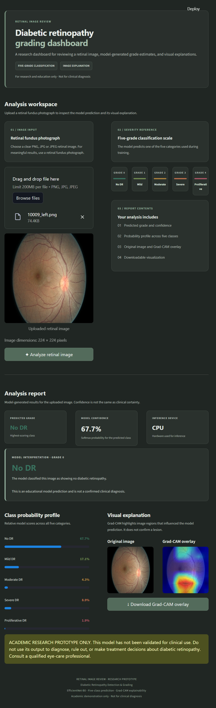

# Retinal Image Review

### A clear, practical workspace for retinal image review.

This academic research dashboard explores diabetic retinopathy grading. Upload a retinal fundus image to review the model's grade estimate, five-class probability profile, and Grad-CAM visualization.

<p align="center">
  
</p>

## Explore the dashboard

- Upload a PNG, JPG, or JPEG retinal fundus photograph.
- Predict one of five grades: **No DR**, **Mild**, **Moderate**, **Severe**, or **Proliferative DR**.
- Review model confidence and probabilities across all five classes.
- Compare the original image with its Grad-CAM overlay and download the visualization.

## Run it locally

Python 3.10 or newer is recommended.

```powershell
git clone https://github.com/varshitha1809/diabetic-retinopathy-detection.git
cd diabetic-retinopathy-detection
python -m venv .venv
.\.venv\Scripts\Activate.ps1
python -m pip install -r requirements.txt
python -m streamlit run app/app.py
```

Then open the local URL printed by Streamlit (usually `http://localhost:8501`).

The app loads `models/final_efficientnet_b0.pth` by default. To use a model file in another location, set `MODEL_PATH` before launching:

```powershell
$env:MODEL_PATH = "C:\path\to\your\model.pth"
python -m streamlit run app/app.py
```

## Project map

```text
.
├── app/
│   └── app.py
├── assets/
│   └── dashboard.png
├── colored_images/                 # Retinal image dataset
├── GradCAM/
│   └── gradcam_all_classes.png
├── models/                          # EfficientNet-B0 checkpoints
├── train.csv
├── requirements.txt
└── README.md
```

## Important: research use only

This academic prototype is not clinically validated. Its predictions and Grad-CAM visualizations are not a diagnosis or medical advice, and must not be used to make care or treatment decisions. Please consult a qualified eye-care professional.
